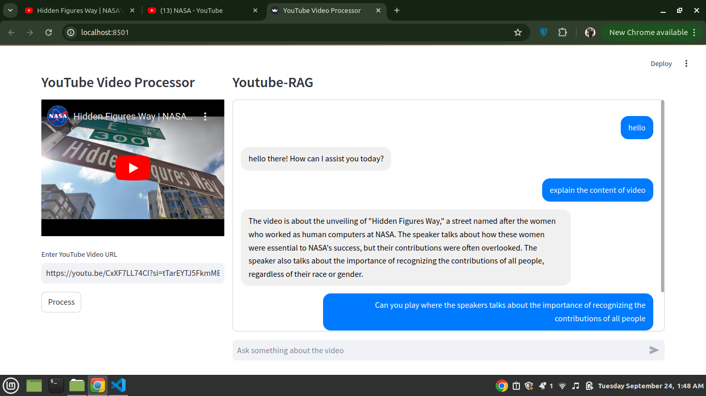

# YouTube-RAG: chat with any YouTube video

Paste a YouTube link, then ask questions about the video. The app answers from the video's own transcript and points you to the exact timestamp, so you can jump straight to the moment instead of scrubbing through it.



## How it works

1. **Transcript:** fetches the video's transcript (with timestamps) in any available language via `youtube-transcript-api`.
2. **Index:** stores the timestamped transcript chunks in **ChromaDB** for fast semantic search.
3. **Retrieve:** for each question, finds the most relevant chunks.
4. **Answer:** **Gemini** (through LangChain) answers using only those chunks and cites the timestamps.

## Features

- Works with `youtube.com/watch?v=` and `youtu.be/` links
- Language picker for videos with several transcripts
- Chat interface that shows where in the video each answer comes from
- Built with **Streamlit**

## Run it

```bash
pip install -r requirements.txt
```

Add your Gemini API key to `config.yaml` (keep this file private and never commit a real key):

```yaml
GOOGLE_API_KEY: your-key-here
```

Then start the app:

```bash
streamlit run main.py
```

## Stack

Python · LangChain · Google Gemini · ChromaDB · Streamlit · youtube-transcript-api
